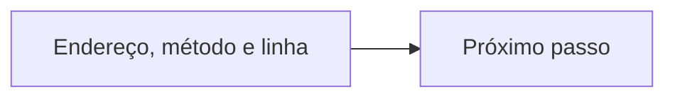

# Explication

## Objetivo

Este projeto é um ambiente de aprendizado. Toda entrega de código precisa deixar o
conhecimento no desenvolvedor, não apenas o arquivo compilando.

A skill converte o diff de uma tarefa em uma aula curta e objetiva: o que mudou, por que
mudou, como cada linha funciona, quais conceitos de Java/Spring/SQL estão por trás, quais
erros são comuns e como provar que o assunto foi absorvido.

## Quando carregar

Carregue esta skill:

- Ao final de qualquer tarefa que tenha **criado, alterado, corrigido, refatorado ou
  analisado código** (`.java`, `.sql`, `.properties`, `pom.xml`, configuração de infra).
- Quando o usuário pedir diretamente uma explicação ("explique", "como funciona",
  "o que é isso", "me ensina", "por que assim e não de outro jeito").
- Depois de uma sessão de debug, explicando a causa raiz e o raciocínio da correção.

Não carregue:

- Em tarefas puramente conversacionais, de status, de planejamento ou de documentação
  sem código-fonte envolvido.
- Duas vezes na mesma tarefa.

## Regras invioláveis

1. **Idioma:** português do Brasil. Termos técnicos permanecem em inglês
   (`Bean`, `Transaction`, `Entity`, `Mapper`, `serialVersionUID`), com tradução curta na
   primeira ocorrência.
2. **Nunca altere código durante a explicação.** Se encontrar bug, inconsistência ou
   melhoria possível, apenas aponte em "Pontos de atenção" e pergunte se deve corrigir.
3. **Nunca explique de memória.** Releia os arquivos com `read_file` após a tarefa e
   explique a versão final que está no disco.
4. **Nunca despeje o arquivo inteiro.** Explique por blocos coesos, sempre citando a
   referência exata no formato [`Arquivo.java`](caminho/Arquivo.java:42). Links de código
   sem número de linha são proibidos.
5. **Explique o "por que" antes do "o que".** Uma linha só é compreendida quando o leitor
   sabe qual problema ela resolve.
6. **Escopo priorizado:** arquivos novos > arquivos alterados > arquivos apenas lidos.
   Máximo de **5 arquivos** em profundidade linha a linha. Se houver mais, explique os 5
   mais relevantes, liste os demais em uma linha cada e ofereça aprofundar.
7. **Profundidade calibrada:** assuma que o leitor domina lógica de programação e
   orientação a objetos básica, mas **não** domina Java moderno (records, `Optional`,
   streams, texto em bloco) nem o ecossistema Spring.
8. **Modo proporcional:** diff pequeno (até ~50 linhas) usa o "Formato enxuto"; diff maior
   usa o "Formato completo".
9. **Zero bajulação.** Sem "ótima pergunta", sem elogios. Direto ao conteúdo.
10. **Sempre feche o ciclo** com exercícios de fixação e um checklist de autoavaliação.

## Formato completo (tarefas médias e grandes)

Produza exatamente estas seções, com estes títulos:

### 1. Resumo em 3 frases

O que a tarefa entregou, qual problema resolve, qual o impacto no sistema.

### 2. Mapa mental

Um diagrama Mermaid `flowchart` mostrando o caminho real do fluxo alterado
(entrada → camadas → saída). Se a tarefa for de banco, use `erDiagram` ou `flowchart`
do script de migration.



### 3. Explicação por arquivo

Para **cada** arquivo priorizado, use esta ordem:

**3.x [`NomeDaClasse`](caminho/Arquivo.java:1) — papel no sistema**

Um parágrafo curto: qual responsabilidade tem, de quem depende e quem depende dele.

**Fluxo de execução:** bullets numerados dizendo quem chama o quê e em que ordem.

**Anotações e imports que importam:** tabela `Anotação/import | o que faz | por que está aqui`.
Só liste o que realmente influencia o comportamento.

**Linha a linha:** copie o bloco relevante com marcadores `// (1)`, `// (2)` e, logo
abaixo, uma lista numerada explicando cada marcador. Explique grupos coesos como uma
unidade quando fizer sentido (ex.: um construtor inteiro), deixando claro quando uma linha
isolada é decisiva.

```java
@Transactional // (1)
public Order create(OrderCommand command) { // (2)
    ...
}
```

1. `@Transactional` abre uma transação por método: se qualquer exceção não tratada sair
   daqui, tudo é desfeito.
2. ...

**Padrões aplicados:** nomeie o padrão (`Value Object`, `Mapper`, `Repository`,
`Use Case`, `DTO`, `Strategy`) e diga em que linha ele aparece.

### 4. Decisões e trade-offs

Tabela: `Decisão | Alternativa descartada | Consequência aceita`. Só decisões reais, com o
motivo técnico e o custo de cada caminho.

### 5. Conceitos-chave para fixar

De 4 a 8 termos, cada um com uma definição de no máximo duas linhas e o ponto do código
onde ele aparece.

### 6. Erros comuns

Mínimo de 3. Formato: "Se você fizer X, acontece Y, porque Z". Priorize erros que
quebrariam este projeto (`@Transactional` ausente, `EnumType.STRING` esquecido, `equals`
do `JPA` etc.).

### 7. Exercícios de fixação

De 2 a 3 exercícios que exijam raciocínio sobre o código entregue (prever saída, propor
teste, alterar regra). Cada enunciado seguido de gabarito dentro de `<details><summary>Gabarito</summary>...</details>`.

### 8. Checklist "consigo explicar sem olhar"

De 5 a 8 perguntas de sim/não cobrindo o que o desenvolvedor deve ser capaz de responder
em uma entrevista técnica.

### 9. Pontos de atenção e próximo passo

Riscos, dívidas técnicas e a recomendação técnica seguinte (uma frase).

## Formato enxuto (diffs pequenos)

1. **O que mudou e por quê** (3 frases).
2. **Linha a linha** apenas do bloco alterado, com marcadores numerados.
3. **Conceito por trás** (1 parágrafo).
4. **1 armadilha** e **1 pergunta** de autoavaliação.

## Regras específicas por tipo de código

- **Entidade JPA / migration SQL:** explique colunas, tipos escolhidos, `CHECK`, `UNIQUE`,
  `FK` e o motivo de cada restrição existir. Diga o que aconteceria sem ela.
- **Domínio (POJO):** destaque invariantes, o que é `private` por quê, e por que métodos
  de mudança de estado existem em vez de setters.
- **Mapper:** explique a fronteira entre domínio e persistência e o custo de manter duas
  representações.
- **Repository/Query:** explique a assinatura derivada (`findByXAndY`) e o impacto do
  índice correspondente.
- **Teste:** explique o arranjo `Arrange / Act / Assert`, o que exatamente está sendo
  provado e por que o teste falharia se a regra fosse removida.
- **Configuração (`application.properties`, `pom.xml`):** explique o efeito de cada
  propriedade no runtime, não apenas o nome.

## Anti-padrões proibidos

- "Este método faz X" sem explicar por que X existe.
- Parafrasear o código sem ligar ao objetivo do sistema.
- Explicação genérica de Java copiada de documentação.
- Bloco de código sem marcadores e sem lista correspondente.
- Terminar sem exercícios e sem checklist.
- Inventar linha ou arquivo que não existe.

## Critério de sucesso

O desenvolvedor deve conseguir, ao final da leitura, **explicar o código para outra pessoa
sem abrir o arquivo** e responder aos exercícios com segurança.
