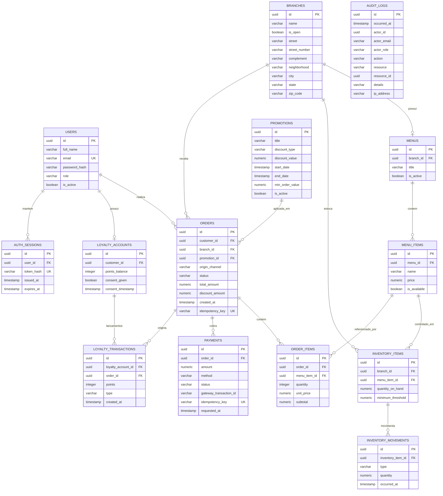

# DER — Modelo de dados do rdn-api

Diagrama derivado de [`V1__schema.sql`](../../src/main/resources/db/migration/V1__schema.sql:1)
e do mapeamento JPA em `src/main/java/com/rdn/rdn_api/infrastructure/persistence/entity/`.
O banco alvo é PostgreSQL; os tipos foram escolhidos para também rodarem em H2
(modo PostgreSQL) nos testes.

## Restrições relevantes

| Regra | Onde está |
|---|---|
| Um usuário por e-mail | `users.email` UNIQUE |
| Um cardápio por filial | `menus.branch_id` UNIQUE |
| Estoque é sempre por filial + item | `inventory_items (branch_id, menu_item_id)` UNIQUE |
| Saldo de estoque não negativo | `ck_inventory_quantity` |
| Pedido sempre tem canal e status válidos | `ck_orders_channel`, `ck_orders_status` |
| Pedido não tem total negativo | `ck_orders_total` |
| Item de pedido tem quantidade positiva e preço copiado | `ck_order_items_quantity`, `unit_price` |
| Pagamento com valor positivo e estados conhecidos | `ck_payments_amount`, `ck_payments_status` |
| Idempotência de pedido e de pagamento | `uk_orders_idempotency_key`, `uk_payments_idempotency_key` |
| Token guardado como hash | `auth_sessions.token_hash` |
| Pontos nunca negativos | `ck_loyalty_points` |
| Promoção aplicada é registrada no pedido | `orders.promotion_id` FK |
| Extrato de fidelidade tem sinal coerente | `ck_loyalty_tx_sign` |
| Auditoria guarda o ator como snapshot, sem FK | `audit_logs.actor_id` + `actor_email` |

## Decisões de modelagem

- **Endereço é value object embutido**: as colunas ficam em `branches` porque
  `Address` é imutável e sem identidade própria.
- **Pagamento desacoplado do pedido**: `payments.order_id` permite múltiplas
  tentativas (aprovada, recusada, falha) sem alterar o pedido.
- **Item de pedido guarda preço unitário**: alteração futura no cardápio não
  reescreve o histórico financeiro.
- **Promoção aplicada no agregado**: `orders.promotion_id` registra a campanha
  usada e `discount_amount` guarda o valor; o cálculo continua no domínio.
- **Pontos assinados no extrato**: `EARNED` grava positivo e `REDEEMED`/`EXPIRED`
  gravam negativo, permitindo conferir o saldo por soma.
- **Auditoria é trilha à parte**: `audit_logs` não tem FK para `users` e guarda
  apenas snapshot do ator e detalhe curto, sem senha, token ou payload completo.
- **`occurred_at`** substitui `timestamp` como nome de coluna em
  `inventory_movements` para não colidir com palavra reservada.
- **Seed de usuários adiado**: `password_hash` exige BCrypt, dependência que
  entra com a camada de segurança. A migration seguinte cria os usuários com
  hash válido gerado por `BCryptPasswordEncoder`.
- **Campanhas na `V5`**: três promoções fixas, sendo uma expirada de propósito
  para o teste negativo de `PROMOCAO_NAO_APLICAVEL`.
