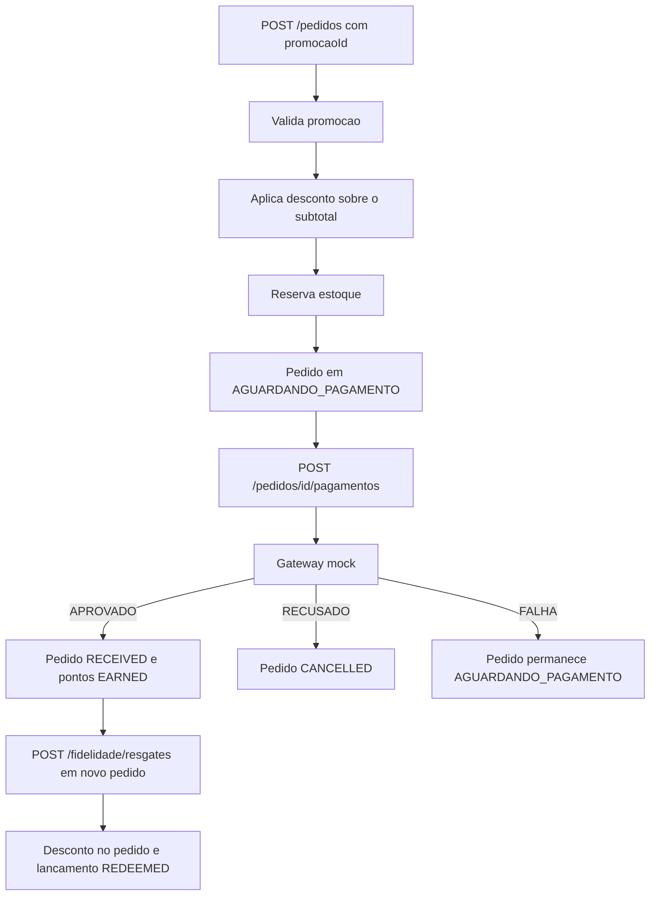

# Etapa 5 — Fidelidade, promoções, auditoria e fechamento do catálogo

> Sucessora natural das Etapas 1 a 4. O fluxo crítico (Pedido → Pagamento mock → Status) já está
> fechado; esta etapa transforma as tabelas `loyalty_accounts`, `loyalty_transactions` e `promotions`,
> que existem desde a `V1` mas não têm caso de uso, em funcionalidade real, e adiciona a
> rastreabilidade exigida pelo critério de Segurança/LGPD/Logs do roteiro.

## Objetivo

Entregar três blocos que o roteiro cobra e o código ainda não cobre:

1. **Fidelidade com consentimento (LGPD)**: opt-in/opt-out explícito, saldo, extrato, acúmulo de
   pontos no pagamento aprovado e resgate aplicado como desconto em um pedido ainda não pago.
2. **Promoções/campanhas**: campanhas semeadas no banco, consulta das campanhas ativas e aplicação
   opcional de uma promoção na criação do pedido, com desconto calculado pelo domínio.
3. **Auditoria de ações sensíveis**: tabela `audit_logs`, registro explícito das ações críticas e
   consulta paginada restrita a `ADMIN`.

Fecha também duas lacunas verificadas no código atual:

- **Consulta de catálogo por unidade** (`GET /unidades` e `GET /unidades/{id}/cardapio`), requisito
  funcional explícito do roteiro que a Etapa 3 não entregou.
- **Erro padrão para parâmetro de query inválido**: hoje `?canalPedido=XYZ` lança
  `MethodArgumentTypeMismatchException`, que cai no handler genérico e responde `500` em vez de `400`.

## Aderência ao roteiro do Projeto Multidisciplinar

A skill `project` (roteiro da Atividade Prática) já está carregada nesta conversa. O plano foi conferido
contra os seis critérios oficiais e cobre o que ainda estava aberto:

| Critério oficial | Como esta etapa contribui | Situação após a etapa |
|---|---|---|
| Análise do Problema e Requisitos (20) | Fidelização com consentimento, promoções/campanhas, multicanalidade já registrada em `canalPedido` e priorização explícita do que fica fora | Completo para o MVP; limites declarados no README da Etapa 6 |
| Modelagem e Arquitetura (20) | Novas tabelas/colunas na `V5`, DER atualizado, portas/adapters nas camadas Domain/Application/Infrastructure/API | Completo |
| Implementação da API e Regras de Negócio (25) | Fluxo crítico já fechado nas Etapas 3–4; esta etapa acrescenta promoção no pedido, pontos e resgate com desconto | Completo para o Fluxo A |
| Segurança, LGPD, Logs/Auditoria (15) | Consentimento explícito, minimização de dados na auditoria, `audit_logs` persistido e `GET /auditoria` restrito a `ADMIN` | Completo |
| Plano de Testes (10) | 12+ cenários novos entre unidade e integração, com positivos e negativos; coleção Postman entra na Etapa 6 | Parcial nesta etapa, completo na Etapa 6 |
| Entrega Técnica e Documentação (10) | Relatório ABNT da etapa e DER; README, Swagger e coleção Postman ficam para a Etapa 6 | Parcial nesta etapa, completo na Etapa 6 |

## Contexto de partida (Etapas 1 a 4 concluídas)

- 13 tabelas em [`V1__schema.sql`](../src/main/resources/db/migration/V1__schema.sql:1), seed de
  filial/cardápio/estoque em [`V2__seed.sql`](../src/main/resources/db/migration/V2__seed.sql:7),
  usuários BCrypt em [`V3__seed_users.sql`](../src/main/resources/db/migration/V3__seed_users.sql:15)
  e o status `AGUARDANDO_PAGAMENTO` em
  [`V4__add_awaiting_payment_status.sql`](../src/main/resources/db/migration/V4__add_awaiting_payment_status.sql:7).
- Fluxo de pedido e pagamento mock funcionando, com idempotência por `Idempotency-Key`, lock
  pessimista no estoque e padrão de erro `ApiError`.
- Segurança stateless com JWT, perfis `ADMIN`, `STAFF`, `KITCHEN`, `CUSTOMER` e rotas declaradas em
  [`SecurityConfig`](../src/main/java/com/rdn/rdn_api/infrastructure/security/SecurityConfig.java:56).
- DER documentado em [`docs/DER.md`](../docs/DER.md:8); relatórios ABNT das Etapas 1 a 4 em `docs/`.

### Lacunas verificadas no código atual

| Lacuna | Evidência |
|---|---|
| Fidelidade e promoções são só persistência | `application/` não possui `loyalty` nem `promotion`; não há controller |
| `Promotion.applyDiscount` usa `getTotalAmount()` | [`Promotion.java`](../src/main/java/com/rdn/rdn_api/domain/Promotion.java:71) — no momento da criação o total ainda é `ZERO`, então percentual calcularia zero |
| `Order` não tem operação de desconto | [`Order.java`](../src/main/java/com/rdn/rdn_api/domain/Order.java:95) só expõe `calculateTotal`; `discountAmount` é setado direto |
| `Order` não referencia promoção | [`OrderJpaEntity`](../src/main/java/com/rdn/rdn_api/infrastructure/persistence/entity/OrderJpaEntity.java:35) não mapeia `promotion_id` e a coluna não existe |
| `LoyaltyAccount.addPoints` aceita negativo | [`LoyaltyAccount.java`](../src/main/java/com/rdn/rdn_api/domain/LoyaltyAccount.java:49) soma qualquer valor |
| Mappers de fidelidade sem `toEntity` | [`LoyaltyAccountMapper`](../src/main/java/com/rdn/rdn_api/infrastructure/persistence/mapper/LoyaltyAccountMapper.java:14) e [`LoyaltyTransactionMapper`](../src/main/java/com/rdn/rdn_api/infrastructure/persistence/mapper/LoyaltyTransactionMapper.java:15) só leem |
| Nenhuma auditoria de ação sensível | não existe tabela, porta, adapter nem chamada nos casos de uso |
| Catálogo não consultável | [`CatalogGateway`](../src/main/java/com/rdn/rdn_api/application/order/CatalogGateway.java:12) só busca por id; não há `GET /unidades` nem cardápio |
| Query param inválido vira 500 | [`GlobalExceptionHandler`](../src/main/java/com/rdn/rdn_api/api/error/GlobalExceptionHandler.java:36) não trata `MethodArgumentTypeMismatchException` |

## Critério de pronto (DoD)

- `V5__loyalty_promotion_audit.sql` aplica em banco limpo depois de `V1`–`V4`.
- `PUT /fidelidade/consentimento` cria/atualiza a conta do cliente; `GET /fidelidade` devolve saldo,
  consentimento e data; `GET /fidelidade/transacoes` devolve extrato paginado.
- Pagamento `APROVADO` de pedido com cliente consentido gera `loyalty_transactions` do tipo `EARNED`;
  replay da mesma `Idempotency-Key` não duplica pontos.
- `POST /fidelidade/resgates` debita pontos e aplica o valor como desconto no pedido, desde que o
  pedido esteja `AGUARDANDO_PAGAMENTO`; responde `409` para consentimento ausente, saldo insuficiente,
  resgate repetido ou pedido em status incompatível.
- `POST /pedidos` aceita `promocaoId` opcional; desconto e total são calculados pelo domínio e
  persistidos; promoção inexistente → `404`; promoção inativa/expirada/fora do mínimo → `409`.
- `GET /promocoes` lista campanhas ativas com indicador de vigência.
- `GET /unidades` e `GET /unidades/{id}/cardapio` respondem catálogo real do banco.
- Ações sensíveis gravadas em `audit_logs` e consultáveis em `GET /auditoria` por `ADMIN`;
  `STAFF`/`CUSTOMER` recebem `403`.
- `GET /pedidos?canalPedido=INVALIDO` responde `400 PARAMETRO_INVALIDO` (não mais `500`).
- `.\mvnw.cmd test` verde, com no mínimo 12 cenários novos entre unidade e integração.
- `docs/DER.md` atualizado e relatório `docs/etapa-5-fidelidade-promocoes-auditoria-abnt.pdf`
  gerado a partir de `tools/abnt_pdf_etapa5.py`.

## Decisões arquiteturais

1. **Resgate fecha o ciclo com desconto no pedido, não com débito solto.** `POST /fidelidade/resgates`
   recebe `pedidoId` e `pontos`, debita a conta e chama `Order.addDiscount(...)`; o pagamento seguinte
   cobra o total já reduzido. Alternativa descartada: resgate como lançamento contábil sem efeito
   prático, que não demonstraria o benefício ao cliente.
2. **Pontos são assinados no extrato.** `EARNED` grava pontos positivos; `REDEEMED` e `EXPIRED` gravam
   negativos. Isso permite `SUM(points)` como conferência do saldo e deixa a direção explícita.
   A `V5` adiciona `ck_loyalty_tx_sign` para o banco recusar lançamento incoerente.
3. **Política de pontos em classe de domínio determinística.** `LoyaltyPolicy` define
   `1 ponto por real pago` (arredondado para baixo) e `1 ponto = R$ 0,10` no resgate. Sem
   aleatoriedade e sem configuração por ambiente, para testes reproduzíveis. Evolução possível:
   externalizar em `application.properties` quando a campanha mudar.
4. **Consentimento é pré-condição de tratamento.** Sem conta ou com `consent_given = false`, o cliente
   não acumula nem resgata pontos. O opt-out preserva o saldo existente, mas congela o uso até novo
   opt-in; o `consent_timestamp` é limpo, como já faz [`LoyaltyAccount.optOut`](../src/main/java/com/rdn/rdn_api/domain/LoyaltyAccount.java:39).
5. **Promoção escolhida explicitamente no pedido.** `promocaoId` é opcional no request; não existe
   "melhor promoção automática", para o total ser previsível e testável. Apenas uma promoção por
   pedido, registrada em `orders.promotion_id`.
6. **Desconto sempre pelo domínio.** `Order.subtotal()` soma os itens; `Order.applyDiscount(valor)`
   limita o desconto ao subtotal e recalcula o total; `Order.addDiscount(valor)` acumula (usado pelo
   resgate sobre uma eventual promoção). O cliente nunca envia `total` nem `desconto`.
7. **Auditoria explícita, não por AOP.** Porta `AuditGateway` na aplicação, adapter em
   `infrastructure/persistence/audit`, chamadas nos casos de uso. Mais linhas que um aspecto, porém
   rastreável e testável. Eventos de autenticação toleram falha de auditoria; mutações de negócio
   gravam na mesma transação (se a regra falhar, o log não mente).
8. **Tabela de auditoria sem FK para `users`.** Guarda `actor_id` e um snapshot de e-mail/perfil para
   sobreviver à desativação do usuário e evitar acoplamento. Não guarda senha, token nem payload
   completo de pagamento — apenas detalhes mínimos e o IP, capturado no adapter via
   `RequestContextHolder`.
9. **Consulta de catálogo reaproveita as portas existentes.** `CatalogGateway` ganha
   `findOpenBranches()` e `findMenuByBranchId(UUID)`; sem novas tabelas e sem duplicar adapters.
10. **`PageResponse` movido para `api/shared`.** Hoje mora em [`api/order/PageResponse.java`](../src/main/java/com/rdn/rdn_api/api/order/PageResponse.java:18);
    fidelidade e auditoria também paginam. É um refactor de duas linhas (`OrderController` + pacote),
    sem mudança de contrato.

## Regras de negócio

### Promoções

| Regra | Comportamento |
|---|---|
| `promocaoId` ausente | pedido segue sem desconto |
| `promocaoId` inexistente | `404 PROMOCAO_NAO_ENCONTRADA` |
| Promoção inativa, fora da janela ou abaixo de `min_order_value` | `409 PROMOCAO_NAO_APLICAVEL` com motivo em `details` |
| Percentual | aplicado sobre o **subtotal** dos itens, com `HALF_UP` em 2 casas |
| Valor fixo | aplicado como está, limitado ao subtotal |
| Desconto maior que o subtotal | truncado ao subtotal por [`Order.applyDiscount`](../src/main/java/com/rdn/rdn_api/domain/Order.java:95) |
| Persistência | `orders.promotion_id` guarda a campanha aplicada; `orders.discount_amount` guarda o valor |

### Fidelidade

| Regra | Comportamento |
|---|---|
| Opt-in | cria `loyalty_accounts` com `points_balance = 0`, `consent_given = true` e timestamp |
| Opt-out | mantém o saldo, marca `consent_given = false` e limpa o timestamp |
| Acúmulo | somente em pagamento `APPROVED`, cliente existente e conta com consentimento; `floor(total)` pontos |
| Idempotência do acúmulo | antes de gravar, verifica `loyalty_transactions` existente para `(order_id, EARNED)` |
| Extrato | ordem decrescente de `created_at`, paginado, com pontos assinados |
| Resgate | exige `CUSTOMER`, conta com consentimento, `pontos > 0` e saldo suficiente |
| Pedido do resgate | precisa ser do próprio cliente e estar em `AGUARDANDO_PAGAMENTO` |
| Limite do resgate | o desconto convertido não pode ultrapassar o saldo devedor do pedido (`subtotal - desconto_atual`) |
| Um resgate por pedido | verificado por `existsByOrderIdAndType(orderId, REDEEMED)`; repetição → `409 RESGATE_JA_APLICADO` |
| Concorrência | conta lida com `@Lock(PESSIMISTIC_WRITE)` antes de debitar |
| Total do pedido | recalculado após o resgate; a cobrança mock passa a usar o novo valor |

### Auditoria

| Ação | Origem | Recurso |
|---|---|---|
| `LOGIN_SUCCESS` / `LOGIN_FAILURE` | [`LoginService`](../src/main/java/com/rdn/rdn_api/application/auth/LoginService.java:45) | `AUTH` |
| `ORDER_CREATED` | [`CreateOrderService`](../src/main/java/com/rdn/rdn_api/application/order/CreateOrderService.java:62) | `ORDER` |
| `ORDER_STATUS_CHANGED` / `ORDER_CANCELLED` | [`ChangeOrderStatusService`](../src/main/java/com/rdn/rdn_api/application/order/ChangeOrderStatusService.java:44) | `ORDER` |
| `PAYMENT_APPROVED` / `PAYMENT_DECLINED` / `PAYMENT_FAILED` | [`RequestPaymentService`](../src/main/java/com/rdn/rdn_api/application/payment/RequestPaymentService.java:55) | `PAYMENT` |
| `PROMOTION_APPLIED` | `CreateOrderService` quando há `promocaoId` | `ORDER` |
| `LOYALTY_CONSENT_GRANTED` / `LOYALTY_CONSENT_REVOKED` | `LoyaltyService` | `LOYALTY_ACCOUNT` |
| `LOYALTY_POINTS_EARNED` / `LOYALTY_POINTS_REDEEMED` | `LoyaltyService` | `LOYALTY_ACCOUNT` |

- `details` é texto curto (`"RECEIVED->PREPARING"`, `"promocao=... desconto=5.18"`), nunca payload
  completo, senha ou token.
- Login não pode quebrar por falha de auditoria: `LoginService` captura a exceção e registra em log
  de aplicação. Nos demais casos, a auditoria participa da transação de negócio.

## Migration V5

Arquivo novo: `src/main/resources/db/migration/V5__loyalty_promotion_audit.sql`.

```sql
-- Etapa 5: auditoria de acoes sensiveis, promocao aplicada ao pedido
-- e consistencia do extrato de fidelidade.
-- Tipos portaveis entre PostgreSQL e H2 em modo PostgreSQL.

CREATE TABLE audit_logs (
    id UUID NOT NULL,
    occurred_at TIMESTAMP NOT NULL,
    actor_id UUID,
    actor_email VARCHAR(160),
    actor_role VARCHAR(20),
    action VARCHAR(60) NOT NULL,
    resource VARCHAR(40) NOT NULL,
    resource_id UUID,
    details VARCHAR(1000),
    ip_address VARCHAR(45),
    CONSTRAINT pk_audit_logs PRIMARY KEY (id),
    CONSTRAINT ck_audit_logs_actor_role CHECK (
        actor_role IS NULL OR actor_role IN ('CUSTOMER', 'STAFF', 'KITCHEN', 'ADMIN'))
);

CREATE INDEX idx_audit_logs_occurred_at ON audit_logs (occurred_at);
CREATE INDEX idx_audit_logs_action ON audit_logs (action);
CREATE INDEX idx_audit_logs_resource ON audit_logs (resource, resource_id);
CREATE INDEX idx_audit_logs_actor ON audit_logs (actor_email);

ALTER TABLE orders ADD COLUMN promotion_id UUID;
ALTER TABLE orders ADD CONSTRAINT fk_orders_promotion
    FOREIGN KEY (promotion_id) REFERENCES promotions (id);
CREATE INDEX idx_orders_promotion ON orders (promotion_id);

ALTER TABLE loyalty_transactions ADD CONSTRAINT ck_loyalty_tx_sign CHECK (
    (type = 'EARNED' AND points > 0) OR
    (type IN ('REDEEMED', 'EXPIRED') AND points < 0));
CREATE INDEX idx_loyalty_tx_order ON loyalty_transactions (order_id);

-- Campanhas de demonstracao. Datas fixas para o teste nao depender do relogio.
INSERT INTO promotions (id, title, description, discount_type, discount_value,
                        start_date, end_date, min_order_value, is_active)
VALUES ('00000000-0000-0000-0000-0000000000c1',
        'Semana do Burger', '10% em pedidos acima de R$ 30,00',
        'PERCENTAGE', 10.00, '2026-01-01 00:00:00', '2027-12-31 23:59:59', 30.00, TRUE),
       ('00000000-0000-0000-0000-0000000000c2',
        'Combo Fidelidade', 'R$ 5,00 de desconto acima de R$ 40,00',
        'FIXED_AMOUNT', 5.00, '2026-01-01 00:00:00', '2027-12-31 23:59:59', 40.00, TRUE),
       ('00000000-0000-0000-0000-0000000000c3',
        'Campanha Encerrada', 'Campanha expirada usada em teste negativo',
        'PERCENTAGE', 15.00, '2025-01-01 00:00:00', '2025-12-31 23:59:59', NULL, TRUE);
```

Observações:

- `V1`–`V4` não são editadas (checksum do Flyway).
- `audit_logs` não tem FK para `users` de propósito.
- O `CHECK` de sinal usa apenas `IN` e comparações simples, suportadas pelo H2 em modo PostgreSQL.
- O seed mantém uma campanha expirada com `is_active = TRUE` para o teste de `PROMOCAO_NAO_APLICAVEL`.

## Domínio

Alterações em [`Order`](../src/main/java/com/rdn/rdn_api/domain/Order.java:24):

- campo `Promotion promotion` + getter/setter;
- `BigDecimal subtotal()`: soma `OrderItem.calculateSubtotal()` sem desconto;
- `BigDecimal applyDiscount(BigDecimal desconto)`: rejeita nulo/negativo, limita ao subtotal, grava
  `discountAmount` e recalcula `totalAmount`;
- `BigDecimal addDiscount(BigDecimal extra)`: acumula sobre o desconto atual e delega para
  `applyDiscount` (usado pelo resgate);
- `calculateTotal()` passa a usar `subtotal()`.

Alterações em [`Promotion`](../src/main/java/com/rdn/rdn_api/domain/Promotion.java:15):

- `boolean isWithinValidity(LocalDateTime instante)`: separa janela de vigência para reutilizar na
  listagem e nos testes;
- `isValidFor(Order)` passa a comparar `order.subtotal()` com `minOrderValue`;
- `applyDiscount(Order)` calcula percentual sobre `order.subtotal()`.

Alterações em [`LoyaltyAccount`](../src/main/java/com/rdn/rdn_api/domain/LoyaltyAccount.java:13):

- `boolean hasConsent()`;
- `addPoints` ignora nulo e valores não positivos (defesa contra lançamento indevido).

Novo `domain/LoyaltyPolicy.java`:

```java
public final class LoyaltyPolicy {
    public static final int POINTS_PER_REAL_EARNED = 1;
    public static final BigDecimal REAL_PER_POINT_REDEEMED = new BigDecimal("0.10");

    public static int earnedPointsFor(BigDecimal total) { ... }
    public static BigDecimal discountFor(int points) { ... }
}
```

Alterações em [`LoyaltyTransaction`](../src/main/java/com/rdn/rdn_api/domain/LoyaltyTransaction.java:12):

- fábricas `earned(account, order, pontos, instante)` e `redeemed(account, order, pontos, instante)`;
- `redeemed` grava `points` negativo; `earned` grava positivo;
- valida conta obrigatória e pontos de entrada positivos.

## Pacotes e classes novas

```text
application/audit/
  AuditGateway              port: record(AuditEntry)
  AuditEntry                record(actorId, actorEmail, actorRole, action, resource, resourceId, details)
  AuditAction               enum LOGIN_SUCCESS, LOGIN_FAILURE, ORDER_CREATED, ORDER_STATUS_CHANGED,
                                  ORDER_CANCELLED, PAYMENT_APPROVED, PAYMENT_DECLINED, PAYMENT_FAILED,
                                  PROMOTION_APPLIED, LOYALTY_CONSENT_GRANTED, LOYALTY_CONSENT_REVOKED,
                                  LOYALTY_POINTS_EARNED, LOYALTY_POINTS_REDEEMED
  AuditQueryService         listagem paginada com filtros
  AuditLogView              record para resposta

application/loyalty/
  LoyaltyAccountGateway     port: findByCustomerId, findForUpdateByCustomerId, saveAccount,
                                  saveTransaction, findTransactions, existsTransaction
  LoyaltyService            consentimento, consulta, resgate e acumulo no pagamento aprovado
  LoyaltyAccountView        record(clienteId, saldoPontos, consentimento, consentimentoEm)
  RedeemPointsCommand       record(pedidoId, pontos)
  RedeemPointsResult        record(pontosResgatados, descontoAplicado, novoSaldo, totalPedido)

application/loyalty/exception/
  ConsentRequiredException          -> 409 CONSENTIMENTO_NECESSARIO
  InsufficientPointsException       -> 409 PONTOS_INSUFICIENTES
  RedemptionAlreadyAppliedException -> 409 RESGATE_JA_APLICADO
  RedemptionExceedsOrderTotalException -> 409 RESGATE_EXCEDE_TOTAL
  RedemptionNotAllowedException     -> 409 RESGATE_NAO_PERMITIDO

application/promotion/
  PromotionGateway          port: findById(UUID), findActive()
  PromotionService          listagem das campanhas ativas
  PromotionView             record com flag vigente
  exception/PromotionNotApplicableException -> 409 PROMOCAO_NAO_APLICAVEL

application/catalog/
  CatalogQueryService       listagem de unidades abertas e cardapio por unidade

infrastructure/persistence/audit/
  AuditLogJpaEntity
  AuditLogJpaRepository
  AuditLogMapper
  AuditGatewayAdapter       grava a tabela e replica em log de aplicacao; le IP via RequestContextHolder

infrastructure/persistence/loyalty/
  LoyaltyAccountGatewayAdapter   LoyaltyAccountJpaRepository + LoyaltyTransactionJpaRepository + mappers
  PromotionGatewayAdapter        PromotionJpaRepository + PromotionMapper

api/loyalty/
  LoyaltyController         GET /fidelidade, GET /fidelidade/transacoes,
                            PUT /fidelidade/consentimento, POST /fidelidade/resgates
  ConsentRequest, LoyaltyAccountResponse, LoyaltyTransactionResponse,
  RedeemPointsRequest, RedeemPointsResponse

api/promotion/
  PromotionController       GET /promocoes
  PromotionResponse

api/catalog/
  CatalogController         GET /unidades, GET /unidades/{id}/cardapio
  BranchResponse, MenuResponse, MenuItemResponse

api/audit/
  AuditController           GET /auditoria
  AuditLogResponse

api/shared/
  PageResponse              movido de api/order (mesmo contrato)
```

## Alterações em arquivos existentes

| Arquivo | Alteração |
|---|---|
| [`OrderJpaEntity`](../src/main/java/com/rdn/rdn_api/infrastructure/persistence/entity/OrderJpaEntity.java:35) | mapear `@ManyToOne promotion` com `@JoinColumn(name = "promotion_id")` |
| [`OrderMapper`](../src/main/java/com/rdn/rdn_api/infrastructure/persistence/mapper/OrderMapper.java:23) | carregar `promotion` apenas em `toDomain` (detalhe), nunca em `toDomainShallow` |
| [`OrderGatewayAdapter`](../src/main/java/com/rdn/rdn_api/infrastructure/persistence/order/OrderGatewayAdapter.java:49) | injetar `PromotionJpaRepository` e setar a referência no insert |
| [`OrderJpaRepository`](../src/main/java/com/rdn/rdn_api/infrastructure/repository/OrderJpaRepository.java:34) | adicionar `promotion` ao `@EntityGraph` de `findWithItemsById` |
| [`CreateOrderService`](../src/main/java/com/rdn/rdn_api/application/order/CreateOrderService.java:62) | injetar `PromotionGateway` e `AuditGateway`; aplicar promoção e auditar criação |
| [`CreateOrderCommand`](../src/main/java/com/rdn/rdn_api/application/order/CreateOrderCommand.java:22) | novo componente `promocaoId` |
| [`CreateOrderRequest`](../src/main/java/com/rdn/rdn_api/api/order/CreateOrderRequest.java:22) | novo campo opcional `promocaoId` |
| [`OrderController`](../src/main/java/com/rdn/rdn_api/api/order/OrderController.java:63) | repassar `promocaoId`; importar `PageResponse` de `api/shared` |
| [`OrderResponse`](../src/main/java/com/rdn/rdn_api/api/order/OrderResponse.java:25) | expor `desconto` e `promocaoId` |
| [`RequestPaymentService`](../src/main/java/com/rdn/rdn_api/application/payment/RequestPaymentService.java:55) | injetar `LoyaltyService` e `AuditGateway`; acumular pontos e auditar o desfecho |
| [`ChangeOrderStatusService`](../src/main/java/com/rdn/rdn_api/application/order/ChangeOrderStatusService.java:44) | injetar `AuditGateway` e registrar transição/cancelamento |
| [`LoginService`](../src/main/java/com/rdn/rdn_api/application/auth/LoginService.java:45) | injetar `AuditGateway`; registrar sucesso/falha com tolerância a erro de auditoria |
| [`LoyaltyAccountJpaRepository`](../src/main/java/com/rdn/rdn_api/infrastructure/repository/LoyaltyAccountJpaRepository.java:15) | adicionar `findForUpdateByCustomerId` com `@Lock(PESSIMISTIC_WRITE)` |
| [`LoyaltyTransactionJpaRepository`](../src/main/java/com/rdn/rdn_api/infrastructure/repository/LoyaltyTransactionJpaRepository.java:16) | adicionar busca paginada e `existsByOrderIdAndType` |
| [`LoyaltyAccountMapper`](../src/main/java/com/rdn/rdn_api/infrastructure/persistence/mapper/LoyaltyAccountMapper.java:14) | adicionar `toEntity` |
| [`LoyaltyTransactionMapper`](../src/main/java/com/rdn/rdn_api/infrastructure/persistence/mapper/LoyaltyTransactionMapper.java:15) | adicionar `toEntity` e `toDomainShallow` |
| [`CatalogGateway`](../src/main/java/com/rdn/rdn_api/application/order/CatalogGateway.java:12) | adicionar `findOpenBranches()` e `findMenuByBranchId(UUID)` |
| [`CatalogGatewayAdapter`](../src/main/java/com/rdn/rdn_api/infrastructure/persistence/order/CatalogGatewayAdapter.java:21) | implementar as duas buscas com `MenuJpaRepository` e `MenuMapper` |
| [`SecurityConfig`](../src/main/java/com/rdn/rdn_api/infrastructure/security/SecurityConfig.java:56) | `/fidelidade/**` → `CUSTOMER`; `/auditoria/**` → `ADMIN`; `/promocoes` e `/unidades/**` → autenticados |
| [`GlobalExceptionHandler`](../src/main/java/com/rdn/rdn_api/api/error/GlobalExceptionHandler.java:36) | handlers das novas exceções + `MethodArgumentTypeMismatchException` → `400 PARAMETRO_INVALIDO` |
| [`SchemaDdlTest`](../src/test/java/com/rdn/rdn_api/infrastructure/persistence/SchemaDdlTest.java:27) | aplicar `V1`–`V5` e validar `audit_logs`, promoções e `orders.promotion_id` |
| [`OrderFlowIntegrationTest`](../src/test/java/com/rdn/rdn_api/api/order/OrderFlowIntegrationTest.java:46) | limpar `audit_logs`/fidelidade no setup e ajustar se necessário |

## Contratos

### `PUT /fidelidade/consentimento` — `CUSTOMER`

Request:

```json
{ "consentimento": true }
```

`200`:

```json
{ "clienteId": "uuid", "saldoPontos": 0, "consentimento": true, "consentimentoEm": "2026-11-13T12:00:00" }
```

Status: `200`, `400` (`DADOS_INVALIDOS`), `401`, `403`.

### `GET /fidelidade` — `CUSTOMER`

`200`:

```json
{ "clienteId": "uuid", "saldoPontos": 51, "consentimento": true, "consentimentoEm": "2026-11-13T12:00:00" }
```

Cliente sem conta responde `200` com `saldoPontos = 0`, `consentimento = false` e
`consentimentoEm = null`; não é erro.

### `GET /fidelidade/transacoes?page=0&limit=10` — `CUSTOMER`

`200`:

```json
{
  "content": [
    { "transacaoId": "uuid", "pontos": -100, "tipo": "REDEEMED", "pedidoId": "uuid", "criadoEm": "2026-11-13T12:10:00" },
    { "transacaoId": "uuid", "pontos": 51, "tipo": "EARNED", "pedidoId": "uuid", "criadoEm": "2026-11-13T12:00:00" }
  ],
  "page": 0, "size": 10, "totalElements": 2, "totalPages": 1
}
```

### `POST /fidelidade/resgates` — `CUSTOMER`

Request:

```json
{ "pedidoId": "uuid", "pontos": 100 }
```

`200`:

```json
{ "pontosResgatados": 100, "descontoAplicado": 10.00, "novoSaldo": 50, "totalPedido": 41.80 }
```

Status: `200`, `400`, `401`, `403`, `404 PEDIDO_NAO_ENCONTRADO`, `409` (`CONSENTIMENTO_NECESSARIO`,
`PONTOS_INSUFICIENTES`, `RESGATE_EXCEDE_TOTAL`, `RESGATE_JA_APLICADO`, `RESGATE_NAO_PERMITIDO`).

### `GET /promocoes` — autenticado

`200`:

```json
[
  { "promocaoId": "uuid", "titulo": "Semana do Burger", "tipoDesconto": "PERCENTAGE",
    "valorDesconto": 10.00, "valorMinimoPedido": 30.00,
    "inicioEm": "2026-01-01T00:00:00", "fimEm": "2027-12-31T23:59:59", "vigente": true }
]
```

### `GET /unidades` — autenticado

`200`:

```json
[
  { "unidadeId": "uuid", "nome": "RDN Centro", "aberta": true,
    "endereco": { "logradouro": "Rua das Laranjeiras", "numero": "100", "complemento": "Loja 1",
                  "bairro": "Centro", "cidade": "Sao Paulo", "estado": "SP", "cep": "01000-000" } }
]
```

### `GET /unidades/{id}/cardapio` — autenticado

`200`:

```json
{ "unidadeId": "uuid", "unidadeNome": "RDN Centro", "cardapioId": "uuid", "titulo": "Cardapio Centro",
  "itens": [ { "produtoId": "uuid", "nome": "X-Burger", "descricao": "Pao, carne...", "preco": 25.90, "disponivel": true } ] }
```

Status: `200`, `401`, `404` (`UNIDADE_NAO_ENCONTRADA` ou `CARDAPIO_NAO_ENCONTRADO`).

### `GET /auditoria?acao=ORDER_CREATED&recursoId=&de=&ate=&page=0&limit=10` — `ADMIN`

`200`:

```json
{
  "content": [
    { "auditoriaId": "uuid", "ocorridoEm": "2026-11-13T12:00:00", "atorEmail": "customer@rdn.local",
      "atorPerfil": "CUSTOMER", "acao": "ORDER_CREATED", "recurso": "ORDER",
      "recursoId": "uuid", "detalhes": "canal=TOTEM total=51.80", "ip": "127.0.0.1" }
  ],
  "page": 0, "size": 10, "totalElements": 1, "totalPages": 1
}
```

Status: `200`, `400 PARAMETRO_INVALIDO`, `401`, `403`.

### `POST /pedidos` — mudança aditiva

Request ganha `promocaoId` opcional:

```json
{
  "canalPedido": "TOTEM",
  "unidadeId": "uuid",
  "formaPagamento": "MOCK",
  "promocaoId": "uuid",
  "itens": [ { "produtoId": "uuid", "quantidade": 2, "observacao": "sem cebola" } ]
}
```

`201` passa a expor `desconto` e `promocaoId`:

```json
{
  "pedidoId": "uuid", "canalPedido": "TOTEM", "status": "AGUARDANDO_PAGAMENTO",
  "unidadeId": "uuid", "total": 46.62, "desconto": 5.18, "promocaoId": "uuid",
  "itens": [ ... ], "criadoEm": "2026-11-13T12:00:00"
}
```

Novos status: `404 PROMOCAO_NAO_ENCONTRADA`, `409 PROMOCAO_NAO_APLICAVEL`.

## Fluxo após a Etapa 5



## Testes

### Unidade

1. `PromotionTest`: percentual sobre o subtotal, valor fixo, janela expirada, inativo, abaixo do
   mínimo, desconto limitado ao subtotal.
2. `LoyaltyPolicyTest`: `floor` do total, conversão de pontos em reais, arredondamento.
3. `CreateOrderServiceTest`: promoção aplicada; promoção inexistente → 404; promoção não aplicável →
   409; sem promoção permanece igual; auditoria registrada.
4. `LoyaltyServiceTest`: opt-in cria conta; opt-out congela; acúmulo idempotente; resgate feliz;
   sem consentimento; saldo insuficiente; pedido em status incompatível; resgate repetido.
5. `RequestPaymentServiceTest`: aprovado acumula pontos; replay não acumula de novo; auditoria do
   desfecho.
6. `ChangeOrderStatusServiceTest`: transição e cancelamento geram auditoria.
7. `LoginServiceTest`: sucesso/falha geram auditoria; falha da auditoria não derruba o login.

### Integração (HTTP real, token via `/auth/login`, H2 em modo PostgreSQL)

8. `POST /pedidos` com `promocaoId` válido → `201` com `desconto` e `total` reduzidos.
9. `POST /pedidos` com promoção expirada → `409 PROMOCAO_NAO_APLICAVEL`; inexistente → `404`.
10. `PUT /fidelidade/consentimento` → `200`; pagamento aprovado → `GET /fidelidade` mostra pontos e
    `GET /fidelidade/transacoes` contém `EARNED`.
11. `POST /fidelidade/resgates` em pedido aguardando pagamento → `200`, total reduzido, saldo debitado;
    repetição → `409 RESGATE_JA_APLICADO`.
12. Resgate sem consentimento → `409 CONSENTIMENTO_NECESSARIO`; saldo insuficiente →
    `409 PONTOS_INSUFICIENTES`.
13. `GET /fidelidade` como `STAFF` → `403`; sem token → `401`.
14. `GET /auditoria` como `ADMIN` → `200` com ações; como `STAFF` → `403`; sem token → `401`.
15. `GET /unidades` e `GET /unidades/{id}/cardapio` → `200`; unidade inexistente → `404`.
16. `GET /pedidos?canalPedido=INVALIDO` → `400 PARAMETRO_INVALIDO`.
17. `SchemaDdlTest`: `V1`–`V5` em banco limpo; `audit_logs` existe; `promotions` tem 3 linhas;
    `orders.promotion_id` existe; `ck_loyalty_tx_sign` contém `EARNED`.

### Cobertura mínima do roteiro

- Positivos: login, criação com promoção, pagamento aprovado com pontos, resgate, extrato, catálogo,
  auditoria.
- Negativos: `401`, `403`, `400` de validação/parametro, `404` de recurso, `409` de promoção,
  consentimento, saldo e transição.

## Riscos

| Risco | Mitigação |
|---|---|
| `ddl-auto=validate` divergir da `V5` | `SchemaDdlTest` aplica `V1`–`V5`; tipos `UUID`, `TIMESTAMP`, `VARCHAR`, `NUMERIC` explícitos |
| `CHECK` de sinal não suportado no H2 | usar apenas `IN` e comparações; validar no `SchemaDdlTest` por `INFORMATION_SCHEMA` |
| Pontos acumulados duas vezes | status `AGUARDANDO_PAGAMENTO` + idempotência + `existsByOrderIdAndType(EARNED)` |
| Resgate duplicado concorrente | lock pessimista na conta + verificação de `REDEEMED` por pedido; documentar a janela |
| Promoção percentual calcular sobre total já descontado | `Promotion.applyDiscount` usa `subtotal()`; teste unitário dedicado |
| `Order` sem promoção na listagem dispara `LazyInitializationException` | promoção só é mapeada no detalhe; listagem usa `toDomainShallow` |
| Auditoria quebrar login | `LoginService` captura falha de auditoria e segue autenticando |
| Auditoria quebrar mutação de negócio | decisão consciente: na mesma transação, o log só existe se a regra existiu |
| Crescimento de `audit_logs` | índices por data/ação/recurso; retenção documentada; sem payload sensível |
| Testes existentes quebram por novos construtores | atualizar `CreateOrderServiceTest`, `RequestPaymentServiceTest`, `ChangeOrderStatusServiceTest`, `LoginServiceTest` |
| Seed de promoções com data fixa envelhece | janela até 2027 documentada; teste de expiração usa a campanha de 2025 |
| Docker ausente para validar PostgreSQL real | manter `SchemaDdlTest`; validação real fica explicitamente para a Etapa 6 |

## Documentação desta etapa

- Atualizar [`docs/DER.md`](../docs/DER.md:8): entidade `AUDIT_LOGS`, relação
  `PROMOTIONS ||--o{ ORDERS`, coluna `orders.promotion_id` e restrição `ck_loyalty_tx_sign`.
- Criar `tools/abnt_pdf_etapa5.py` reaproveitando `tools/abnt_pdf.py` e gerar
  `docs/etapa-5-fidelidade-promocoes-auditoria-abnt.pdf` com Introdução, Arquitetura e escopo,
  Modelagem e implementação, Decisões e trade-offs, Conceitos fundamentais, Erros comuns, Exercícios,
  Checklist, Considerações finais e próximo passo, Referências.
- Registrar no relatório que o resgate é aplicado como desconto, que pontos são assinados e que a
  auditoria não guarda dados sensíveis.

## Pontos para validação antes da implementação

1. **Conversão de pontos**: `1 ponto por real pago` e `1 ponto = R$ 0,10` no resgate. Se a intenção
   for outra proporção, ajustar `LoyaltyPolicy` antes dos testes.
2. **Resgate como desconto**: exige `pedidoId` e pedido em `AGUARDANDO_PAGAMENTO`. Alternativa mais
   simples seria débito de pontos sem pedido, mas perderia a demonstração ponta a ponta.
3. **Escopo do catálogo**: apenas leitura (`GET /unidades` e cardápio). CRUD de filial/cardápio e
   endpoints de estoque continuam fora do MVP.
4. **Auditoria de login**: inclui tentativa com e-mail inexistente/senha errada. Se a política de
   retenção exigir menos, remover `LOGIN_FAILURE` do escopo.

## Depois desta etapa (Etapa 6 — Entrega)

O plano detalhado da etapa seguinte está em [`plans/06-entrega-openapi-postman.md`](06-entrega-openapi-postman.md).

- Adicionar `springdoc-openapi` compatível com Spring Boot 4 (verificar a versão 3.x do starter antes
  de escrever o `pom.xml`) e liberar `/swagger-ui/**` e `/v3/api-docs/**` no `SecurityConfig`.
- README reprodutível: requisitos, `.env.example`, Docker, Flyway `V1`–`V5`, execução, Swagger,
  testes, usuários de seed, decisões e limites declarados.
- Coleção Postman/Insomnia com no mínimo 10 cenários (6 positivos e 4 negativos), organizada em
  Auth, Pedidos, Pagamento, Fidelidade, Promoções, Auditoria e Erros.
- Validação em PostgreSQL real via `docker-compose.yml`; se o Docker continuar indisponível,
  documentar a limitação e manter a evidência do `SchemaDdlTest`.
- Relatório final único em PDF cobrindo todas as etapas, com DER, diagramas, contratos, LGPD,
  auditoria, plano de testes e conclusão.

## Fora de escopo desta etapa

- CRUD administrativo de filiais, cardápios e promoções.
- Endpoints de entrada/saída de estoque (Fluxo B); a restrição de venda por saldo já existe.
- Refresh token, logout e uso de `auth_sessions`.
- Provedor de pagamento real; o mock continua sendo o provedor.
- Retenção/anonimização automática de `audit_logs`; a política fica documentada.
