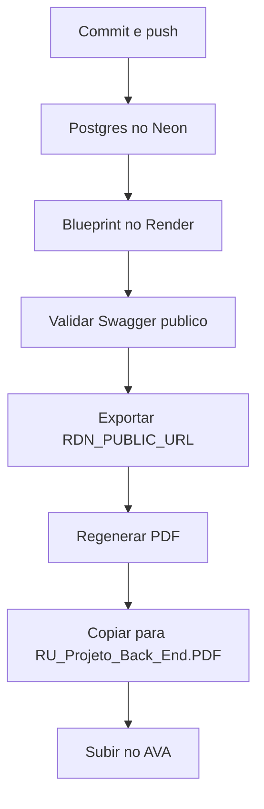

# Plano de correção e organização — entrega final RDN-API

Objetivo: fechar os pontos que ainda impedem a nota máxima e deixar o PDF pronto para upload,
sem depender de decisões pendentes no momento do envio.

## 1. Diagnóstico verificado (estado atual)

> Verificado em 23/11/2026, com `main` sincronizada em `origin/main`.

| Item | Situação | Evidência |
|---|---|---|
| Código e testes | 98 testes, 0 falhas | `.\mvnw.cmd -B -ntp test` → BUILD SUCCESS |
| Wrapper Maven | funciona em clone limpo (baixa Maven 3.10.0, sem jar versionado) | [`.mvn/wrapper/maven-wrapper.properties`](../../.mvn/wrapper/maven-wrapper.properties:2) |
| Swagger na aplicação | público, sem token | [`SecurityConfig.java`](../../src/main/java/com/rdn/rdn_api/infrastructure/security/SecurityConfig.java:59) |
| Deploy | artefatos **commitados** (`299e3a9`); serviço no Render ainda responde `404` (`x-render-routing: no-server`) | [`Dockerfile`](../../Dockerfile:1), [`render.yaml`](../../render.yaml:8) |
| Config de host | porta via `PORT`, proxy headers, OpenAPI relativo | [`application.properties`](../../src/main/resources/application.properties:5) |
| README | seção 7.1 com o host do blueprint (`rdn-api.onrender.com`); falta validar o `200` | [`README.md`](../../README.md:171) |
| PDF | 18 páginas, conteúdo completo, **ainda em modo local** (regenerar após o deploy) | [`abnt_pdf_final.py`](../../documentacao/tools/abnt_pdf_final.py:22) |
| Repositório remoto | `main` e `origin/main` no mesmo commit (build, OpenAPI, deploy, config e docs) | [`.git/config`](../../.git/config:12) |

## 2. Decisões de entrega

| Decisão | Escolha | Motivo |
|---|---|---|
| Hospedagem da API | Render, runtime Docker, plano free | `render.yaml` já pronto; build remoto não depende da máquina do autor |
| Banco | PostgreSQL gerenciado externo (Neon) | plano free do Render não mantém Postgres permanente |
| Fonte da URL no PDF | variável de ambiente `RDN_PUBLIC_URL` no gerador | permite gerar o PDF antes e depois do deploy sem editar texto |
| PDF | sempre regenerado por script, nunca editado à mão | evita divergência entre texto e formatação |
| Submissão | `4885643_Projeto_Back_End.PDF` na raiz (ignorado pelo Git) | padrão de nome do roteiro |



## 3. Fase 0 — Congelar o estado e commitar

> **Executado em 23/11/2026.** Foram criados cinco commits (`536ec02`, `be306ec`, `299e3a9`,
> `f0aa0c0`, `4ebbbc1`) e o `git push origin main` deixou `main` e `origin/main` no mesmo
> commit. O bloco abaixo fica como referência do agrupamento usado.

Comandos na raiz do projeto:

```bat
.\mvnw.cmd -B -ntp test
git status --short
```

Commits sugeridos, um por assunto (mantém o histórico apresentável, requisito de 5+ commits):

```bat
git add src/main/java/com/rdn/rdn_api/application/payment/RequestPaymentService.java src/test/java/com/rdn/rdn_api/application/loyalty/LoyaltyServiceTest.java pom.xml
git commit -m "chore(build): remove imports nao usados e comentario vazio no pom"

git add Dockerfile .dockerignore render.yaml
git commit -m "feat(deploy): adiciona imagem multi-stage e blueprint do Render"

git add src/main/resources/application.properties src/main/java/com/rdn/rdn_api/infrastructure/config/OpenApiConfig.java .env.example
git commit -m "feat(config): porta via PORT, forward headers e servidor relativo no OpenAPI"

git add README.md
git commit -m "docs(readme): deploy, Swagger publico e evidencias atualizadas"

git push origin main
```

Critério de aceite da fase: `git status` limpo e `git log --oneline -1` mostrando o commit de docs.

## 4. Fase 1 — Banco no Neon

1. Criar projeto no Neon (região mais próxima, ex.: `us-east-1`), banco `neondb`.
2. Copiar a connection string e converter para JDBC:
   `jdbc:postgresql://<host>/neondb?sslmode=require`
3. Guardar três valores fora do repositório: `DB_URL`, `DB_USER`, `DB_PASSWORD`.
4. Não criar tabelas manualmente: o Flyway aplica `V1`–`V5` no primeiro boot.
5. Teste rápido opcional (se houver `psql` ou container):
   `psql "postgresql://<user>:<pass>@<host>/neondb?sslmode=require" -c "select 1"`

## 5. Fase 2 — Deploy no Render

1. Render → **New → Blueprint** → selecionar o repositório → aplicar `render.yaml`.
2. Preencher no dashboard: `DB_URL`, `DB_USER`, `DB_PASSWORD`. (`JWT_SECRET` é gerado.)
3. Acompanhar o log: build do Docker, Flyway `V1`–`V5`, `Started RdnApiApplication`.
4. Health check do blueprint: `GET /v3/api-docs` deve responder `200`.

Validação obrigatória (substituir `<URL>`):

```bat
curl -s -o NUL -w "%%{http_code}\n" https://<URL>/v3/api-docs
curl -s -o NUL -w "%%{http_code}\n" https://<URL>/swagger-ui.html

curl -s -X POST https://<URL>/auth/login ^
  -H "Content-Type: application/json" ^
  -d "{\"email\":\"customer@rdn.local\",\"senha\":\"Customer@123\"}"
```

Esperado: `200`, `200` e JSON com `accessToken`. Em seguida, no Swagger público, executar o Fluxo A
com os IDs semeados (`...0001` unidade, `...0003` produto, `...00c1` promoção) e confirmar
`AGUARDANDO_PAGAMENTO` → pagamento `APPROVED` → pedido `RECEIVED`.

## 6. Fase 3 — README, Postman e Docker Compose

### 6.1 README

- Linha da evidência "Swagger público": placeholder substituído pelo host do blueprint em
  [`README.md`](../../README.md:336); ainda é preciso confirmar o `200` após o deploy.
- Seção 6: acrescentar nota de que em Linux/macOS o wrapper pode exigir `chmod +x mvnw`.
- Seção 12: registrar que, para rodar a coleção contra o deploy, o `baseUrl` do environment deve ser trocado.

### 6.2 Environment Postman público (feito)

[`rdn-api.postman_environment.public.json`](../../postman/rdn-api.postman_environment.public.json:4)
criado com `baseUrl = https://rdn-api.onrender.com` (host do blueprint) e os mesmos IDs de seed.
A coleção tem 29 requisições (T01–T25 do roteiro mais variantes), então o avaliador roda direto no
deploy. Falta apenas confirmar a URL depois que o serviço existir.

### 6.3 Serviço `api` no Docker Compose (feito)

Implementado atrás do profile `full` em [`docker-compose.yml`](../../docker-compose.yml:23), para não
conflitar com quem roda a aplicação pelo wrapper:

```yaml
  api:
    profiles: ["full"]
    build: .
    ports:
      - "8080:8080"
    environment:
      DB_URL: jdbc:postgresql://postgres:5432/rdn
      DB_USER: rdn
      DB_PASSWORD: rdn
      JWT_SECRET: rdn-api-dev-secret-key-change-me-32b
    depends_on:
      postgres:
        condition: service_healthy
```

Quem só tem Docker roda `docker compose --profile full up -d --build` e obtém banco + API + Swagger.

## 7. Fase 4 — Correções no gerador do PDF

> **Aplicado.** Os itens 7.1 a 7.6 já estão no script e o PDF de `documentacao/docs/` foi regenerado
> (18 páginas). Falta apenas regerar com `RDN_PUBLIC_URL` depois que o deploy responder `200`.

Arquivo único: [`abnt_pdf_final.py`](../../documentacao/tools/abnt_pdf_final.py).

### 7.1 URL pública por variável de ambiente (linhas 17–19)

```python
OUTPUT = "documentacao/docs/projeto-back-end-final-abnt.pdf"
REPO_URL = "https://github.com/FxlipxDPaula/rdn-api"
PUBLIC_URL = os.environ.get("RDN_PUBLIC_URL", "").rstrip("/")
FIG_DIR = os.path.join("documentacao", "docs", "diagrams")
```

### 7.2 Tabela 2 — acrescentar desempenho e disponibilidade (após a linha 88)

```python
            ["Desempenho em pico", "Paginacao nas listagens, indices por canal/status e pool Hikari"],
            ["Disponibilidade", "API stateless com JWT, health check em /v3/api-docs e reinicio pelo provedor"],
```

### 7.3 Feature crítica — acrescentar pós-condições (bloco das linhas 116–122)

```python
    report.p(
        "Feature critica: Realizar pedido e solicitar pagamento. Pre-condicao: usuario autenticado e "
        "unidade aberta. Fluxo principal: cria o pedido, valida catalogo, aplica promocao opcional, baixa "
        "estoque, solicita o pagamento mock com chave de idempotencia e atualiza o status conforme o "
        "resultado. Pos-condicoes: pedido persistido com status coerente, estoque debitado na unidade, "
        "evento gravado em audit_logs e pontos creditados quando o pagamento e aprovado e ha "
        "consentimento. Excecoes: estoque insuficiente, produto inexistente, promocao invalida, chave "
        "reutilizada e pagamento recusado.",
    )
```

### 7.4 Seção 6 — camadas, evidências e parágrafo do Docker (bloco das linhas 350–376)

```python
    report.h1("ENTREGA TECNICA E DOCUMENTACAO")
    report.p(
        "A solucao esta separada em quatro camadas. domain concentra entidades e invariantes (Order, "
        "Promotion, LoyaltyAccount e LoyaltyPolicy) e nao importa JPA. application expoe casos de uso e "
        "portas para pedidos, pagamento, fidelidade, promocoes, catalogo, usuarios e auditoria. "
        "infrastructure implementa as portas com JPA, mappers, repositorios Spring Data, JWT, gateway de "
        "pagamento mock, auditoria e OpenAPI. api expoe controllers, DTOs de request/response e o ApiError "
        "padronizado, aplicando autenticacao e autorizacao por perfil.",
    )
    report.table(
        "Evidencias de entrega",
        ["Evidencia", "Local"],
        [
            ["Repositorio publico", REPO_URL],
        ] + ([
            ["Swagger UI (publico)", PUBLIC_URL + "/swagger-ui.html"],
            ["OpenAPI JSON (publico)", PUBLIC_URL + "/v3/api-docs"],
        ] if PUBLIC_URL else [
            ["Swagger UI", "http://localhost:8080/swagger-ui.html apos executar o README"],
            ["OpenAPI JSON", "http://localhost:8080/v3/api-docs apos executar o README"],
        ]) + [
            ["Colecao Postman", REPO_URL + "/blob/main/postman/rdn-api.postman_collection.json"],
            ["Environment Postman", REPO_URL + "/blob/main/postman/rdn-api.postman_environment.json"],
            ["DER", "documentacao/docs/DER.md"],
            ["Diagramas", "documentacao/docs/diagrams/*.png e documentacao/tools/render_diagrams.py"],
            ["Relatorios por etapa", "documentacao/docs/etapa-1 a etapa-5"],
            ["Relatorio final", "documentacao/docs/projeto-back-end-final-abnt.pdf"],
            ["Imagem Docker", "Dockerfile multi-stage e render.yaml (deploy com PostgreSQL externo)"],
        ],
        widths=[0.34, 0.66],
    )
    report.p(
        "A imagem e construida pelo Dockerfile multi-stage e publicada no Render a partir do render.yaml, "
        "com PostgreSQL gerenciado externo. O Flyway aplica V1 a V5 no primeiro boot e o SchemaDdlTest "
        "cobre as mesmas migrations em banco limpo. A reproducao local continua documentada no README.",
    )
```

### 7.5 Declaração de uso de IA sem numeração (linha 463)

```python
    report.h1("DECLARACAO DE USO DE IA", numbered=False)
```

### 7.6 Referência do roteiro (lista das linhas 447–461)

```python
        "CENTRO UNIVERSITARIO INTERNACIONAL UNINTER. Roteiro de Atividade Pratica de Projeto "
        "Multidisciplinar: trilha Back-end. 2026.",
```

### 7.7 Sumário — verificar antes de mexer

A extração de texto do PDF atual mostra `31 INTRODUCAO E OBJETIVOS`, o que sugere número de página
antes do título. Isso pode ser apenas artefato do extrator (as linhas de pontos aparecem
separadas). **Passo obrigatório:** abrir o PDF e olhar o sumário na tela. Se estiver visualmente
correto, não alterar. Se estiver realmente fora de ordem, o ajuste é em
[`abnt_doc.py`](../../documentacao/tools/abnt_doc.py:109): dar `rightIndent`, `firstLineIndent=0` e
`spaceBefore` a `TOC_1`/`TOC_2`, mantendo `dotsMinLevel = 0`; a substituição do TOC provisório pelo
definitivo já existe em [`abnt_doc.py`](../../documentacao/tools/abnt_doc.py:313).

### 7.8 Acentuação (opcional, apenas apresentação)

O corpo do texto está em ASCII. Aplicar acento em todo o relatório exige um mapa de palavras e
risco de acentuar identificadores. Abordagem segura, se o tempo permitir: função `acentuar(texto)`
com `re.sub` por palavra inteira, aplicada **somente** em `p()`, `h1()`, `h2()` e legendas — nunca em
`code()`. Ganho: qualidade de apresentação; custo: revisão manual de ~60 palavras.

## 8. Fase 5 — Gerar, validar e renomear o PDF

```bat
set "RDN_PUBLIC_URL=https://<URL>"
python documentacao/tools/abnt_pdf_final.py
copy /Y documentacao\docs\projeto-back-end-final-abnt.pdf 4885643_Projeto_Back_End.PDF
```

Checklist de validação no PDF gerado:

- [ ] Sumário legível e com numeração de páginas correta.
- [ ] Tabela 6 com as linhas "Swagger UI (publico)" e "OpenAPI JSON (publico)"; nenhuma ocorrência de `localhost` como evidência principal.
- [ ] Links da coleção Postman apontando para `github.com/.../blob/main/postman/...`.
- [ ] Tabela 2 com 10 linhas (incluindo desempenho e disponibilidade).
- [ ] Seção 3.1 com "Pos-condicoes".
- [ ] Seção 6 com o parágrafo das quatro camadas.
- [ ] Declaração de IA sem número, antes das referências.
- [ ] Nenhum placeholder (`<servico>`, `<URL>`) restante.
- [ ] Arquivo final `4885643_Projeto_Back_End.PDF` aberto e conferido.

## 9. Fase 6 — Publicar

1. `git push` de tudo (inclui o commit do gerador com as correções).
2. Aquecer a URL do Render (primeiro acesso após hibernação leva ~50 s).
3. Abrir a URL em janela anônima: repositório, Swagger e raw da coleção Postman.
4. Subir `4885643_Projeto_Back_End.PDF` no AVA.
5. Manter a URL viva até a correção (ping periódico, se possível).

## 10. Critérios de aceite (Definition of Done)

- Repositório público com os 6 commits desta fase e README refletindo a URL real.
- `https://<URL>/swagger-ui.html` abre em navegador anônimo, sem token.
- Fluxo A executável pelo Swagger público com usuário semeado.
- Coleção Postman importável, com `baseUrl` funcional (local ou público).
- PDF final: 18+ páginas, sem `localhost` como evidência principal, com todas as seções do roteiro.
- Arquivo nomeado `4885643_Projeto_Back_End.PDF` e enviado no AVA.

## 11. Riscos e plano B

| Risco | Impacto | Mitigação |
|---|---|---|
| Render free hiberna | avaliador vê erro no primeiro acesso | aquecer antes da correção; ping periódico |
| 512 MB de RAM | OOM no boot | `JAVA_TOOL_OPTIONS=-XX:MaxRAMPercentage=70` já no blueprint; se persistir, plano pago ou reduzir heap |
| Neon suspende por inatividade | primeira conexão lenta | primeira requisição após acordar a URL |
| Render indisponível no dia | sem link público | alternativa Railway/Koyeb/Fly com o mesmo `Dockerfile`; ou VPS com compose |
| JDK 25 ausente na máquina do avaliador | não consegue rodar local | URL pública elimina a necessidade; `mvnw test` também exige JDK 25 |
| PDF gerado sem a URL | volta ao problema original | gerar somente depois de `RDN_PUBLIC_URL` apontar para uma URL que responde 200 |

## 12. Organização final do material

```text
raiz do repositorio
  Dockerfile, render.yaml, .dockerignore   infraestrutura de deploy (versionado)
  README.md                                execucao, deploy, evidencias (versionado)
  postman/                                 colecao + environment local + publico (versionado)
  src/                                     codigo, migrations e testes (versionado)
  documentacao/docs/                       DER, diagramas, relatorios por etapa, PDF final (versionado)
  documentacao/tools/                      geradores de diagramas e PDF (versionado)
  4885643_Projeto_Back_End.PDF             arquivo de submissao (ignorado pelo Git)
  .env                                     segredos locais (ignorado pelo Git)
```
